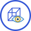

# ComputerVision

<p align="center">
  <a href="https://andrew1407.github.io/ComputerVision/" title="Open the labs in the browser">
    
  </a>
</p>

[](https://andrew1407.github.io/ComputerVision/)

A collection of computer-graphics and computer-vision labs in **Python**, progressing
from raster primitives and 3D projections to OpenCV image processing and YOLO object
detection. Labs 1–5 and the control task draw with a Tkinter-based `graphics.py` (John
Zelle's graphics library); lab 6 renders in real time with OpenGL/GLUT; image work uses
OpenCV, NumPy and Matplotlib.

## Labs

| Lab | Topic |
|---|---|
| [`1-lab`](1-lab) | Calculation strategies — scalar vs. sequential/composed matrix pipelines |
| [`2-lab`](2-lab) | Spatial transforms — axonometric projection, custom rotation, layered drawing |
| [`3-lab`](3-lab) | Raster algorithms — Bresenham lines, vertical intersection, contour extraction |
| [`4-lab`](4-lab) | Vector graphics — least-squares fitting, painter's algorithm, orthogonal projection |
| [`5-lab`](5-lab) | Fractals — Sierpinski carpet and a recursive fractal tree |
| [`6-lab`](6-lab) | OpenGL/GLUT — interactive 3D bearing model |
| [`7-lab`](7-lab) | OpenCV — image transforms and histograms |
| [`8-lab`](8-lab) | Image segmentation — Otsu thresholding, k-means, Roberts cross |
| [`9-lab`](9-lab) | Object detection — YOLOv3 on highway-traffic video (OpenCV DNN) |
| [`control-task`](control-task) | 3D face model with plane-normal back-face culling |

## Showcase

**[Open the labs in the browser](https://andrew1407.github.io/ComputerVision/)**. Every lab runs its own Python source in [PyScript](https://pyscript.net) (Pyodide), with editable parameters, and every drawing, image, chart, table and result can be copied.

- **Labs 1–5 and `control-task`** run their `main.py` and `graphics.py` unchanged. [`web/shims/tkinter.py`](web/shims/tkinter.py) stands in for Tk and records every canvas call, and `time.sleep` advances a virtual clock. The page replays the drawing on an HTML canvas at the lab's timing, including the click `getMouse()` waits for.
- **Lab 6** runs `bearing.py` and `hollow_cylinder.py` unchanged against [`web/shims/OpenGL`](web/shims/OpenGL), a stand-in for PyOpenGL. The page calls the lab's GLUT display callback every animation frame and draws the result with WebGL, using OpenGL 1.x's fixed-function lighting. That part is a port, because browsers have no desktop OpenGL.
- **Labs 7 and 8** call the labs' OpenCV and SciPy functions on the repo's images or an uploaded one. The page draws the images and histograms that matplotlib would show.

[`web/showcase.py`](web/showcase.py) loads the labs. Run it locally:

```sh
mkdir -p _site/web && cp web/*.html web/*.js web/*.py web/*.toml web/*.svg _site/web/ && cp -r web/shims _site/web/
cp -r 1-lab 2-lab 3-lab 4-lab 5-lab 6-lab 7-lab 8-lab control-task _site/
cd _site && python -m http.server    # then open http://localhost:8000/web/
```

The [pages workflow](.github/workflows/pages.yml) deploys it on every push to `main`.

## Stack

- **Python** with **NumPy** and `math` for the geometry
- **Tkinter** through the local `graphics.py` for the 2D drawing labs, and **PyOpenGL** (GLUT) for lab 6's real-time rendering
- **OpenCV** (`cv2`) and **Matplotlib** for image processing and visualization

## Run

Each lab is self-contained — run its `main.py` from inside the lab directory:

```bash
cd 8-lab
python main.py
```

Dependencies: `pip install numpy opencv-python matplotlib PyOpenGL PyOpenGL_accelerate`.
Lab 9 additionally needs the YOLOv3 weights/config placed under `9-lab/model/`.
